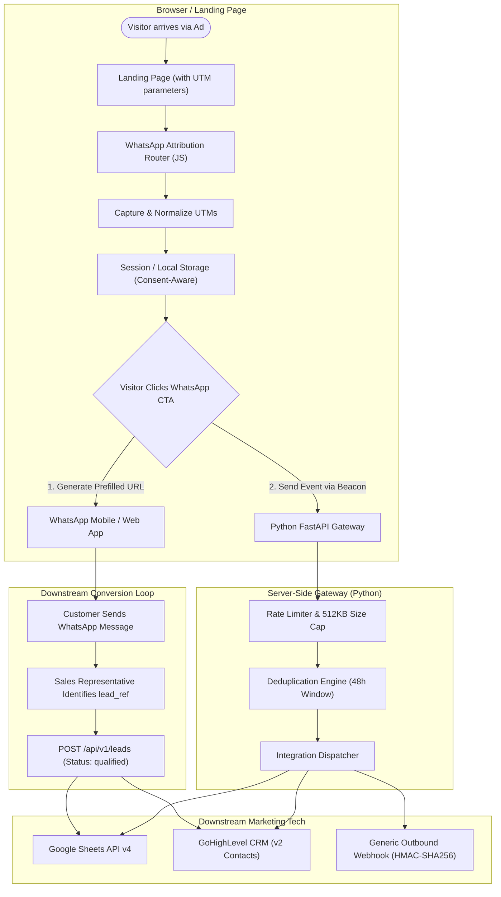

# WhatsApp Attribution Router

[](https://github.com/hamid-digitalmarketer/whatsapp-attribution-router/actions/workflows/ci.yml)
[](LICENSE)
[](backend/)
[](src/)

> **"Turn WhatsApp Clicks into Trackable, Campaign-Attributed Leads."**  
> An open-source JavaScript and Python toolkit that captures UTM campaign parameters, generates attributed WhatsApp click-to-chat links, and synchronizes lead events with Google Sheets, GoHighLevel CRM, or outbound webhooks.

---

## The Business Problem

Performance marketers and digital agencies spend thousands of dollars every month on **Meta Ads (Click-to-WhatsApp)**, **Google Search Ads**, and paid social campaigns. 

However, the moment a prospect leaves a landing page and jumps into the WhatsApp messaging interface, **standard analytics break into a complete black box**:

1. **Lost Campaign Context:** Sales reps answering WhatsApp messages have no idea which ad, keyword, or campaign prompted the inquiry.
2. **Attribution Blind Spots:** Advertising algorithms (Meta CAPI, Google Ads Smart Bidding) optimize blindly on button clicks rather than actual qualified conversations or closed revenue.
3. **Disorganized Inbound Volume:** High-ticket leads get lumped together with casual, unqualified queries without CRM lead tagging or offline conversion loops.

---

## The Solution

**WhatsApp Attribution Router** bridges the gap between web analytics and direct chat apps:

- **Client-Side Parameter Capture:** Captures `utm_source`, `utm_medium`, `utm_campaign`, `utm_content`, `utm_term`, `gclid`, and `fbclid` with zero third-party cookies or fingerprinting.
- **Dynamic WhatsApp Routing:** Formats official WhatsApp click-to-chat links (`https://wa.me/...`) with prefilled messages referencing the exact campaign name and an opaque lead reference token (`lead_ref`).
- **Parallel Server-Side Dispatch:** Dispatches an event payload via `navigator.sendBeacon` or async fetch to a lightweight Python FastAPI gateway.
- **Downstream Synchronization:** Automatically logs click rows to **Google Sheets**, syncs contacts and attribution tags to **GoHighLevel CRM**, and signs outbound webhooks for agency automations.

---

## Architecture & Data Flow



---

## Key Features

- **Lightweight Vanilla JavaScript (<4 KB):** No heavy frameworks, zero runtime dependencies, UMD/ESM/browser-global compatible.
- **Configurable Attribution Models:** Supports **Last Touch** (default), **First Touch**, or **Multi-Touch** records.
- **Direct Traffic Preservation:** Returning visitors who navigate directly do not erase previously established campaign attribution.
- **Privacy First & Zero Fingerprinting:** Fully configurable storage (`sessionStorage`, `localStorage`, or in-memory only) with consent callback support. No PII stored in the browser.
- **Robust Phone Normalization:** Cleans local formatting (e.g. `03167417135` or `+92 316 7417135` → `923167417135`) according to official WhatsApp specifications.
- **Production-Grade Python Gateway:** FastAPI with Pydantic v2 validation, 48-hour event deduplication, IP sliding-window rate limiting, and request size caps.
- **Tested Integrations:** Pre-built adapters for **Google Sheets API v4**, **GoHighLevel LeadConnector v2 API**, and **Outbound Webhooks**.
- **Interactive SaaS Demonstration:** Includes a complete browser simulation sandbox in `demo/`.

---

## WhatsApp Prefilled Message Examples

When a visitor clicks your WhatsApp contact button, the router generates a professional, formatted prefilled message:

```text
Hi, I'm interested in your services.

Campaign ref: lahore_property_leads
Source: google
Medium: cpc
Ref: lead_99a8b7c6
```

> **Technical Honesty Note:** A WhatsApp button click represents an initiated inquiry, **not a guaranteed conversation or sale**. The user may edit or delete the prefilled message before sending. True lead qualification occurs when the message is delivered and confirmed by your team or CRM.

---

## Quick Start: Frontend Integration

### 1. Embed Script Tag
Add `attribution-router.js` before your closing `</body>` tag:

```html
<!-- Include WhatsApp Attribution Router -->
<script src="src/attribution-router.js"></script>

<!-- Add WhatsApp Contact Button with data attribute -->
<a href="#" data-wa-button id="hero-whatsapp-cta" class="whatsapp-btn">
  Chat on WhatsApp
</a>

<script>
  document.addEventListener('DOMContentLoaded', function () {
    const router = new WhatsAppAttributionRouter({
      phoneNumber: '923167417135',
      storageType: 'sessionStorage',
      attributionModel: 'last_touch',
      buttonSelector: '[data-wa-button]',
      apiEndpoint: 'https://api.yourdomain.com/api/v1/events',
      defaultMessage: 'Hi, I reviewed your services and would like to discuss a project.'
    });

    router.init();
  });
</script>
```

---

## Quick Start: Backend Setup

### 1. Install Dependencies
```bash
cd backend
python -m venv .venv
source .venv/bin/activate  # On Windows: .venv\Scripts\activate
pip install -r requirements.txt
```

### 2. Configure Environment
```bash
cp ../.env.example .env
```

Configure your `.env` variables:
```env
APP_NAME="WhatsApp Attribution Router"
API_KEY=your_secret_admin_key_here
PORT=8000

# Optional Integrations
GOOGLE_SHEETS_ENABLED=true
GOOGLE_SHEETS_SPREADSHEET_ID=your_spreadsheet_id_here

GHL_ENABLED=true
GHL_API_KEY=your_ghl_v2_api_key
GHL_LOCATION_ID=your_location_id
```

### 3. Launch Development Server
```bash
uvicorn app.main:app --host 0.0.0.0 --port 8000 --reload
```

---

## REST API Reference

### `POST /api/v1/events`
Public ingestion endpoint for browser attribution clicks.

**Request Payload:**
```json
{
  "event_name": "whatsapp_click",
  "event_id": "evt_abc12345",
  "occurred_at": "2026-10-19T10:30:00Z",
  "lead_reference": "lead_99a8b7c6",
  "session_id": "ses_44d3e2f1",
  "attribution": {
    "model": "last_touch",
    "utm_source": "google",
    "utm_medium": "cpc",
    "utm_campaign": "lahore_property_leads",
    "utm_term": "commercial real estate",
    "gclid": "Cj0KCQjws_example"
  },
  "page": {
    "landing_page": "https://example.com/services",
    "referrer": "https://www.google.com/"
  },
  "destination": {
    "type": "whatsapp",
    "phone_number": "923167417135",
    "button_id": "hero-whatsapp-cta"
  }
}
```

**Response (200 OK):**
```json
{
  "status": "accepted",
  "event_id": "evt_abc12345",
  "lead_reference": "lead_99a8b7c6",
  "deduplicated": false,
  "dispatched_destinations": ["google_sheets", "outbound_webhook"],
  "destination_results": {
    "google_sheets": { "status": "success", "updated_rows": 1 }
  }
}
```

---

### `POST /api/v1/leads`
Protected endpoint for submitting or updating verified lead statuses from CRM callbacks or forms. Requires `X-API-Key` or `Authorization: Bearer <key>`.

**Request Payload:**
```json
{
  "lead_reference": "lead_99a8b7c6",
  "contact": {
    "first_name": "Hamid",
    "last_name": "Consultant",
    "phone": "+923167417135",
    "email": "client@example.com"
  },
  "lead_status": "qualified",
  "attribution": {
    "utm_source": "google",
    "utm_campaign": "lahore_property_leads"
  },
  "notes": "Verified client looking for tracking setup."
}
```

---

## Automated Testing & Quality Checks

Run the automated test suite across JavaScript and Python:

```bash
# 1. Run JavaScript Unit Tests (Node native runner)
npm test

# 2. Run Python Backend Unit & Integration Tests
python -m pytest backend/tests -v

# 3. Verify Code Quality & Linting
ruff check backend
ruff format --check backend
```

---

## Need Better WhatsApp Lead Attribution?

Running Google Ads or Meta Ads that generate WhatsApp inquiries, but struggling to identify which campaigns bring in your highest-converting leads?

I help performance marketing agencies, real estate developers, e-commerce stores, and high-ticket service companies design and implement practical marketing attribution and automation workflows:

- **End-to-End WhatsApp Lead Attribution:** Connect landing page visits and ad spend with incoming WhatsApp chats.
- **Server-Side Conversion Tracking:** Meta Conversions API (CAPI), Google Enhanced Conversions, and Server-Side GTM.
- **Google Sheets & CRM Sync:** Streamline incoming lead logging into Google Sheets, GoHighLevel, HubSpot, or custom databases.
- **Algorithmic Ad Waste Elimination:** Analyze search query reports to prevent negative intent bleed and reclaim wasted ad budget.

---

## Let's Turn Your WhatsApp Leads into Measurable Results

Running ads that generate WhatsApp inquiries but struggling to identify which campaigns bring in your best leads? I can help implement a tracking workflow that connects campaign data, WhatsApp inquiries, and your CRM so your team can make more informed marketing decisions.

**WhatsApp:** [+92 316 7417135](https://wa.me/923167417135)  
**Direct Contact Link:** [https://wa.me/923167417135](https://wa.me/923167417135)

---

## License

This project is licensed under the [MIT License](LICENSE).
