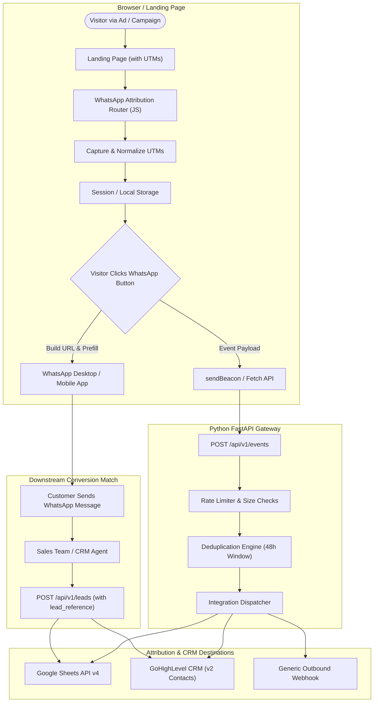

# System Architecture & Data Flow

WhatsApp Attribution Router (`whatsapp-attribution-router`) bridges top-of-funnel campaign clicks with private, direct WhatsApp messaging conversations and downstream CRM records.

## High-Level Architecture Diagram

## Core Components

### 1. Frontend JavaScript Router (`src/attribution-router.js`)
- Runs client-side on your landing page.
- Parses standard attribution query parameters (`utm_source`, `utm_medium`, `utm_campaign`, `utm_content`, `utm_term`, `gclid`, `gbraid`, `wbraid`, `fbclid`).
- Isolates first-touch vs. last-touch attribution models.
- Sanitizes input values to prevent header or URL injection.
- Generates official WhatsApp click-to-chat links (`https://wa.me/<number>?text=<encoded_message>`).
- Emits custom DOM events (`whatsapp:click`) for Google Tag Manager, Meta Pixel, or GA4 triggers.

### 2. Python FastAPI Gateway (`backend/app/`)
- Public ingestion endpoint `POST /api/v1/events` for browser click tracking.
- Protected server endpoint `POST /api/v1/leads` for verified sales and CRM lead updates.
- 48-hour event deduplication engine with thread-safe in-memory cache.
- Sliding-window rate limiting (120 req/minute per IP).
- Request body size limiter (512 KB).

### 3. Google Sheets Adapter (`backend/app/integrations/google_sheets.py`)
- Official Google Sheets API v4 append row integration.
- Appends attribution data into standard audit columns.

### 4. GoHighLevel CRM Adapter (`backend/app/integrations/gohighlevel.py`)
- LeadConnector v2 API client.
- Maps campaign parameters, contact details, tags, and custom fields without creating fake ghost contacts.

### 5. Generic Outbound Webhook (`backend/app/integrations/webhook.py`)
- Forwards payloads to any agency CRM or automation tool (e.g. n8n, Make, Zapier).
- HMAC SHA-256 signature verification via `X-WAR-Signature`.
